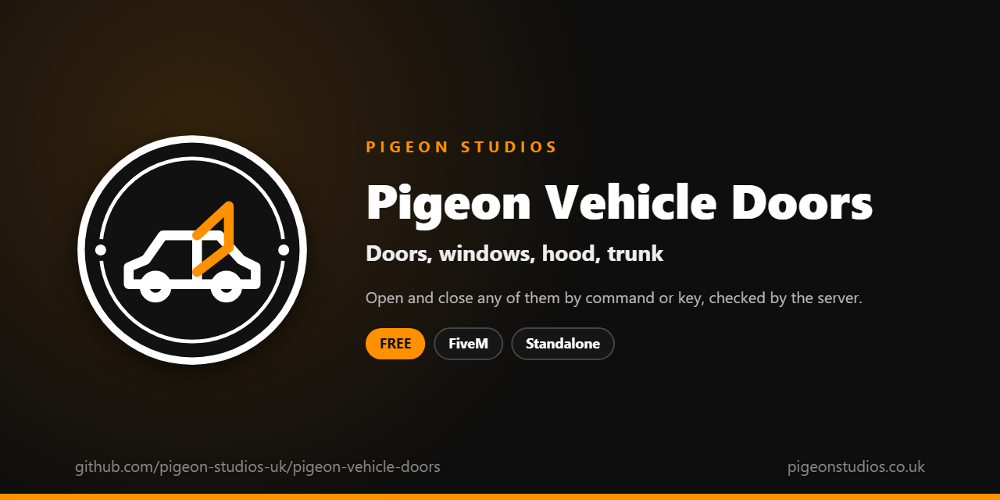

<div align="center">
  

  <h1>Pigeon Vehicle Doors</h1>

  <p><strong>Open and close vehicle doors, windows, the hood and the trunk by command or key, checked by the server and synced for everyone.</strong></p>

  <p>
    <a href="https://github.com/pigeon-studios-uk/pigeon-vehicle-doors/releases/latest"></a>
    <a href="LICENSE.md"></a>
    <a href="https://discord.gg/2NFVWEUmDF"></a>
    
  </p>

  <p>
    <a href="https://github.com/pigeon-studios-uk/pigeon-vehicle-doors/releases/latest"><strong>Download</strong></a> ·
    <a href="#installation">Install</a> ·
    <a href="#configuration">Configure</a> ·
    <a href="CHANGELOG.md">Changelog</a> ·
    <a href="https://discord.gg/2NFVWEUmDF">Support</a>
  </p>
</div>

---

## Contents

- [Overview](#overview)
- [Features](#features)
- [Requirements](#requirements)
- [Installation](#installation)
- [Updating](#updating)
- [Configuration](#configuration)
- [Localisation](#localisation)
- [Commands and exports](#commands-and-exports)
- [How it works](#how-it-works)
- [Update checker](#update-checker)
- [Performance](#performance)
- [Security](#security)
- [Troubleshooting](#troubleshooting)
- [FAQ](#faq)
- [Support](#support)
- [Contributing](#contributing)
- [Licence](#licence)
- [Credits](#credits)

## Overview

Pigeon Vehicle Doors is a free resource by [Pigeon Studios](https://pigeonstudios.co.uk) that lets players open and close a vehicle's doors, windows, hood and trunk. Traffic stops need a window down, searches need the trunk open, mechanics need the hood up, and scenes look better with a door left open. GTA only opens a door when someone gets in or out.

`/door`, `/window`, `/hood` and `/trunk` do it, or keys players choose. In a vehicle they work on that vehicle; on foot, on the nearest unlocked one. The server checks every request, so players can't open other people's locked cars or doors across the map, and everyone sees the same thing.

## Features

- **Four commands.** `/door`, `/window`, `/hood` and `/trunk`, each with an optional key players pick.
- **One door or all.** `/door 1` to `4` or `/door all`, or just `/door` for your own door, or the one you're standing next to.
- **Windows that stay put.** Window positions are kept on the vehicle, so players who arrive later see them too.
- **Driver's rules.** Passengers only open their own door and window; the driver opens everything. Or let anyone.
- **Locks respected.** On foot, locked vehicles stay shut, and windows only work from inside.
- **Checked by the server.** Distance, seat, lock and rate checks on every request.
- **23 languages.** Follows ox_lib's language, or set your own.
- **Standalone.** No framework or other resources needed.

## Requirements

| Requirement | Version | Notes |
|---|---|---|
| FXServer | A [recommended artifact](https://runtime.fivem.net/artifacts/) | |
| OneSync | On | The default on current servers |
| [ox_lib](https://github.com/communityox/ox_lib) | Optional | Used for messages and the language if it's running |

**Frameworks:** none needed. It works the same on standalone and vMenu servers, ESX Legacy, QBCore, Qbox and ox_core.

## Installation

1. **Download** `pigeon-vehicle-doors.zip` from the [latest release](https://github.com/pigeon-studios-uk/pigeon-vehicle-doors/releases/latest). Don't use the green **Code** button; release zips are the tested builds.
2. **Extract** it into your server's `resources` folder. The folder must be called `pigeon-vehicle-doors`.
3. **Start it** by adding this to `server.cfg`, after ox_lib if you use it:

   ```cfg
   ensure pigeon-vehicle-doors
   ```

4. **Configure** it in `configuration/config.lua` if you want to change anything. The defaults work as they are.
5. **Restart** your server. The console shows one line from the update checker:

   ```text
   [Pigeon Studios] Pigeon Vehicle Doors v1.0.0 is up to date.
   ```

## Updating

1. Read the [changelog](CHANGELOG.md) for every version between yours and the latest, especially any **Upgrade notes**.
2. Back up your `configuration/` and `locales/` folders.
3. Replace the `pigeon-vehicle-doors` folder with the new release.
4. Copy your changed settings into the new `configuration/config.lua`. Don't copy the old file over the new one; new versions can add settings.
5. Restart the resource.

## Configuration

All settings are in `configuration/config.lua`, each explained by a comment next to it.

| Setting | Default | What it does |
|---|---|---|
| `Config.Locale` | `'auto'` | The language. `'auto'` follows ox_lib's; or a code such as `'de'` (see [Localisation](#localisation)) |
| `Config.Commands` | `door, window, hood, trunk` | The command names |
| `Config.Keys` | `all `''`` | Default keys for the four commands without a number. `''` leaves them unbound until a player picks one |
| `Config.Distance` | `5.0` | How close, in metres, a player on foot must be to the vehicle |
| `Config.PassengersOwnOnly` | `true` | Passengers only use their own door and window. `false` lets anyone in the vehicle use any of them |
| `Config.ShowMessages` | `true` | Tell players why they can't open something |
| `Config.Notifications` | `'auto'` | `'auto'` (ox_lib if it's running), `'ox_lib'` or `'gta'` |

## Localisation

Pigeon Vehicle Doors comes in 23 languages: `en` English, `cs` Czech, `da` Danish, `de` German, `es` Spanish, `et` Estonian, `fi` Finnish, `fr` French, `hr` Croatian, `hu` Hungarian, `id` Indonesian, `it` Italian, `nl` Dutch, `no` Norwegian, `pl` Polish, `pt` Portuguese, `pt-br` Brazilian Portuguese, `ro` Romanian, `sl` Slovenian, `sv` Swedish, `tr` Turkish, `zh-cn` Simplified Chinese and `zh-tw` Traditional Chinese. They're the languages ox_lib ships, so your server may already have one set.

With `Config.Locale = 'auto'` (the default), it uses ox_lib's language, so one line in `server.cfg` sets it for this and every other resource that follows ox_lib:

```cfg
setr ox:locale "de"
```

Use `setr`, not `set`, so players' games get it too. Without it, or for a language that isn't in `locales/`, the text is English. To choose a language for this resource only, set `Config.Locale` to its code, such as `'fr'` or `'pt-br'`.

The key binding names in GTA's settings are set the first time a player joins, in the language the server had then. Chinese text can show as blank in GTA's own text, such as its notifications, because GTA only loads its Chinese font when the game itself is set to Chinese. ox_lib's notifications show every language.

Every file was checked for missing text and placeholders, but not every translation has been read by a native speaker yet. If something reads wrong, please send a fix; see [Contributing](#contributing). To add a language, copy `locales/en.lua` to a new file named with the language's code (such as `ja.lua`), change `Locales.en` at the top to match (`Locales.ja`), and translate the text in quotes.

## Commands and exports

### Commands

Doors and windows are numbered the same way: **1** the driver's, **2** the front passenger's, **3** behind the driver and **4** behind the front passenger.

| Command | Who | What it does |
|---|---|---|
| `/door` | Everyone | In a vehicle, open or close your own door. On foot, the door of the nearest vehicle you're standing closest to |
| `/door 1`–`4` | Everyone | Open or close that door |
| `/door all` | Everyone | Open all the doors if any is shut, otherwise shut them all |
| `/window` | In a vehicle | Roll your own window down or up |
| `/window 1`–`4` or `all` | In a vehicle | Roll that window, or all of them, down or up |
| `/hood` | Driver, or on foot | Open or close the hood |
| `/trunk` | Driver, or on foot | Open or close the trunk |

With `Config.PassengersOwnOnly` (the default), passengers can only use their own door and window, and only the driver can use the others, the hood and the trunk. The command names change with `Config.Commands`, for example to `bonnet` and `boot`.

### State bag

Each vehicle with a window down has a replicated `pigeonWindows` state bag, set by the server. It's a number with one bit for each window that's down (1 for the driver's, 2 the front passenger's, 4 and 8 the rear), or `nil` when they're all up:

```lua
-- Server or client: is the driver's window down?
local windows = Entity(vehicle).state.pigeonWindows or 0
local driverDown = windows & 1 ~= 0
```

## How it works

When a player uses a command, their game works out which vehicle (the one they're in, or the nearest within `Config.Distance` on foot), which doors or windows (the numbers given, their own, or the door they're nearest), and whether to open or close them. It checks the vehicle has those doors and isn't locked, and that a passenger isn't reaching for someone else's door. Then it asks the server.

The server checks the request again: the vehicle exists, the player is in it in the right seat or on foot close to it, it isn't locked, windows are only asked for from inside, and the player isn't sending requests too fast. It drops anything that fails.

For doors, the server sends the request to the game that controls the vehicle, which opens or closes them, and the game syncs the doors to everyone as it does any door. For windows, the server keeps which ones are down in the vehicle's `pigeonWindows` state bag; every game rolls the windows to match when it changes, and when the vehicle comes into range, so players who arrive later see the same windows.

## Update checker

When it starts, Pigeon Vehicle Doors checks our public [version registry](https://github.com/pigeon-studios-uk/pigeon-versions) once and prints one line in the server console saying whether it's up to date. If there's an update, it shows what's new and where to get it. The check is a single request to GitHub and sends nothing about your server or players.

Control it for every Pigeon Studios resource at once in `server.cfg`:

```cfg
set pigeon_update_check "on"      # default: one line per resource
set pigeon_update_check "quiet"   # only when there's an update or a problem
set pigeon_update_check "off"     # never check
```

## Performance

Nothing runs until a player uses a command. Each command is one small message to the server and back, and window changes are one state bag update. Nothing runs on the server between requests.

## Security

- The server checks every request: the vehicle exists, the player is in it in the right seat or on foot within `Config.Distance` (plus a little for lag), it isn't locked, the door and window numbers are valid, and the player isn't sending more than about five a second. Anything else is dropped.
- Players can't open locked vehicles from outside, and can't use windows from outside at all.
- The window state bag is set only by the server, so players' games can't change it directly.
- The only network request is the update check at start-up, from the server to GitHub. It sends nothing about your server or players.

Found a problem? Please don't open a public issue. Use the **Report a vulnerability** button in this repository's **Security** tab, or follow our [Security Policy](https://github.com/pigeon-studios-uk/.github/blob/main/SECURITY.md).

## Troubleshooting

**Nothing happens.**
On foot, stand within `Config.Distance` of the vehicle and make sure it's unlocked. With `Config.ShowMessages`, a message says why. In a passenger seat, you can only use your own door and window.

**A door opens and closes straight away.**
Another resource is shutting the door, or the vehicle's controller changed at the same moment. Try again; if it keeps happening, look for a resource that closes doors every frame.

**The wrong door opens on a vehicle.**
Some modded vehicles have their doors set up in a different order. Numbers follow GTA's own door order, which most vehicles use.

**A window won't roll up.**
Broken windows can't be rolled up; they're fixed when the vehicle is repaired.

**The text is in the wrong language.**
Check `setr ox:locale` in `server.cfg` (with `setr`, not `set`), or set `Config.Locale` to the language's code.

**The console says "isn't in the version registry" or "couldn't check for updates".**
Your server couldn't reach GitHub, or the check is blocked by a firewall. The resource works normally either way. Turn the check off with `set pigeon_update_check "off"`.

## FAQ

**Is it really free?**
Yes. Use it on as many servers as you like, including ones that take donations. You just can't reupload, resell or bundle it. See [Licence](#licence).

**Does it work on standalone and vMenu servers?**
Yes. It needs no framework at all, and works alongside vMenu.

**Does it work with my vehicle lock resource?**
Yes, if the lock resource uses GTA's door locks, which almost all do. Locked vehicles stay shut to players on foot.

**Does it work with ox_target or a radial menu?**
Yes. They're separate. Menus can run the commands, such as `ExecuteCommand('trunk')`.

**Does it need OneSync?**
Yes, for the server checks and the windows state bag. OneSync is on by default on current servers.

## Support

Read [Troubleshooting](#troubleshooting) first, then ask in the support channels of our [Discord](https://discord.gg/2NFVWEUmDF). Please include your Pigeon Vehicle Doors version, FXServer artifact and any errors from the console (F8 in game). See [Getting help](https://github.com/pigeon-studios-uk/.github/blob/main/SUPPORT.md).

Found a bug? Open a [bug report](https://github.com/pigeon-studios-uk/pigeon-vehicle-doors/issues/new/choose).

## Contributing

Fixes, improvements and translations are welcome. Please read the [contributing guide](https://github.com/pigeon-studios-uk/.github/blob/main/CONTRIBUTING.md) first, and open a feature request before working on anything big.

## Licence

Pigeon Vehicle Doors is free to use under the **[Pigeon Studios Free Licence](LICENSE.md)**.

- ✅ Use it on any number of servers, including monetised ones
- ✅ Change it for your own servers
- ✅ Show it in videos and streams
- ❌ Don't reupload, share or mirror the files; link to this repository instead
- ❌ Don't sell it, bundle it in packs, or put it behind escrow
- ❌ Don't remove the credits

This summary isn't the licence; [LICENSE.md](LICENSE.md) is. Third-party components are listed in [NOTICE.md](NOTICE.md).

## Credits

Made by [Pigeon Studios](https://pigeonstudios.co.uk). Thanks to everyone who has contributed fixes and translations; see the [changelog](CHANGELOG.md).

<sub>Not affiliated with or endorsed by Rockstar Games, Take-Two Interactive or Cfx.re.</sub>
